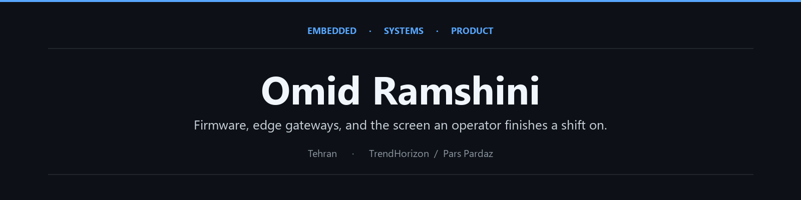
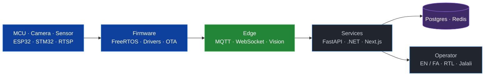

<!-- github.com/omidram — profile README -->

<p align="center">
  
</p>

<p align="center">
  <a href="https://github.com/omidram">
    
  </a>
</p>

<p align="center">
  <a href="mailto:omid40210@gmail.com"></a>
  <a href="https://www.linkedin.com/in/omid-ramshini-775137243/"></a>
  <a href="https://t.me/Omid_Ram"></a>
  <a href="https://github.com/omidram"></a>
  
</p>

I take a system from the pin to the person on shift: the MCU or camera, the firmware, the gateway, then the screen. The rooms are plants, airports, fleets, clinics, and buildings. When the floor speaks Persian, the product does too — right to left, on a Jalali calendar, with the workflow the last shift already knew.

At **TrendHorizon / Pars Pardaz** that means hardware, the edge, and the operator software in one line of delivery.

```text
silicon  →  RTOS firmware  →  edge gateway  →  APIs  →  operator
```

### How the work is judged

| | |
| --- | --- |
| **Firmware** | FreeRTOS, DMA-aware drivers, OTA that can roll back |
| **Interface** | Bilingual EN/FA, Jalali dates, a shift that can finish the task |
| **Vision** | OpenCV, ONNX, and YOLO where the site can actually run them |
| **Delivery** | CMake, PlatformIO, Docker, GitHub Actions, modules with tests |

### Selected systems

Six public systems. A runway, a conveyor, a desk terminal, a recorder, a company workspace, and a cargo desk.

<table>
<tr>
<td width="50%" valign="top">

**[سامانه پایش و ایمنی باند](https://github.com/omidram/airport-runway-monitor)**  
Persian runway console for Imam Khomeini. Live views, YOLOv8 and COCO in the browser, incidents, and a handover the next operator can read.

</td>
<td width="50%" valign="top">

**[ITF luggage scanner](https://github.com/omidram/itf-luggage-scanner)**  
Interleaved 2 of 5 tags on a belt near 1 m/s. C++, OpenCV, USB, RTSP, HTTP, and ONVIF.

</td>
</tr>
<tr>
<td width="50%" valign="top">

**[Kairos](https://github.com/omidram/kairos-stm32f746-desk)**  
Touch-first desk terminal on STM32F746G-DISCOVERY and LVGL 9.

</td>
<td width="50%" valign="top">

**[بالابان](https://github.com/omidram/balaban)**  
Lightweight Ubuntu NVR. Live RTSP, go2rtc, ffmpeg recording, Persian RTL.

</td>
</tr>
<tr>
<td width="50%" valign="top">

**[همکار](https://github.com/omidram/hamkar)**  
Enterprise workspace: CRM, tasks, chat, letters, invoices. FastAPI, Postgres row-level security, Redis, React.

</td>
<td width="50%" valign="top">

**[شیدور](https://github.com/omidram/shidvar)**  
B2B cargo matching. Requester, supplier, driver, and admin, with live tracking and e-POD.

</td>
</tr>
</table>

**Also in the field** — [ParsCam](https://github.com/omidram/parscam) · [ESP32-CAM WebRTC](https://github.com/omidram/esp32-cam-webrtc-streamer) · [تپش](https://github.com/omidram/tapesh) · [آروکسیس](https://github.com/omidram/aroxis) · [نسل فردا](https://github.com/omidram/nasl-farda-tracker) · [همسایه](https://github.com/omidram/building-manager) · [FlightRadar Pro](https://github.com/omidram/flightradar-pro) · [مالیات‌یار](https://github.com/omidram/maliyat-yar)

A private electrolyzer desk is in production beside these: Next.js and FastAPI in place of an Access plant application, bilingual, with the spreadsheets and inspection grids the floor already uses.

### Stack

<p align="center">
  
</p>

<p align="center">
  
  
  
  
  
  
  
  
  
  
</p>

### Shape of a system



### Record

<p align="center">
  
  
</p>

<p align="center">
  
</p>

### On the bench

- ESP32 and STM32 templates with OTA, CI artifacts, and host-side tests
- Driver BSPs for I²C, SPI, UART, and DMA, exercised off the board
- Operator dashboards that keep the pace of the floor
- Vision pipelines that a second engineer can still own after handover

### A conversation

Firmware that survives the field, an edge gateway, or a Persian product the shift will actually use.

<p align="center">
  <a href="mailto:omid40210@gmail.com"></a>
  <a href="https://www.linkedin.com/in/omid-ramshini-775137243/"></a>
  <a href="https://t.me/Omid_Ram"></a>
</p>

<p align="center">
  <sub>Tehran · TrendHorizon / Pars Pardaz</sub>
</p>
