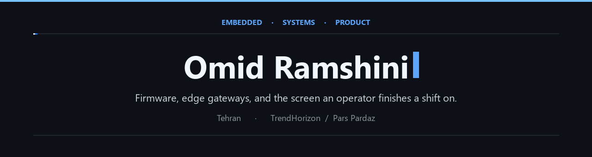
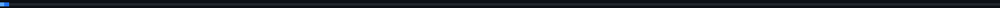
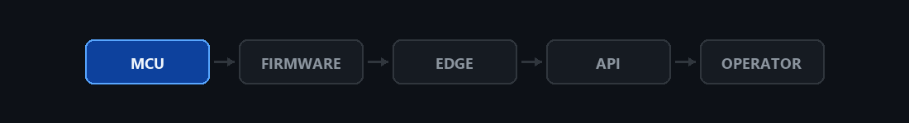
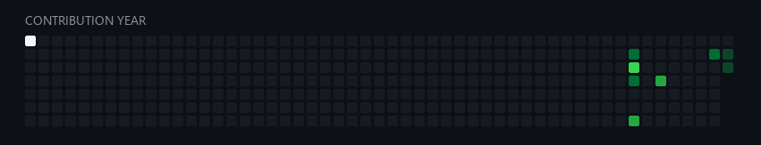

<!-- github.com/omidram — profile README -->

  

  

  

  
  
  
  
  

  
  
  
  
  

  

I take a system from the pin to the person on shift: the MCU or camera, the firmware, the gateway, then the screen. The rooms are plants, airports, fleets, clinics, and buildings. When the floor speaks Persian, the product does too — right to left, on a Jalali calendar, with the workflow the last shift already knew.

At **TrendHorizon / Pars Pardaz** that means hardware, the edge, and the operator software in one line of delivery.

  

### How the work is judged

| | |
| --- | --- |
| **Firmware** | FreeRTOS, DMA-aware drivers, OTA that can roll back |
| **Interface** | Bilingual EN/FA, Jalali dates, a shift that can finish the task |
| **Vision** | OpenCV, ONNX, and YOLO where the site can actually run them |
| **Delivery** | CMake, PlatformIO, Docker, GitHub Actions, modules with tests |

### Selected systems

Six public systems. A runway, a conveyor, a desk terminal, a recorder, a company workspace, and a cargo desk.

<table>
<tr>
<td width="50%" valign="top">

 
**[سامانه پایش و ایمنی باند](https://github.com/omidram/airport-runway-monitor)**
 Persian runway console for Imam Khomeini. Live views, YOLOv8 and COCO in the browser, incidents, and a handover the next operator can read.
  

</td>
<td width="50%" valign="top">

 
**[ITF luggage scanner](https://github.com/omidram/itf-luggage-scanner)**
 Interleaved 2 of 5 tags on a belt near 1 m/s. C++, OpenCV, USB, RTSP, HTTP, and ONVIF.
  

</td>
</tr>
<tr>
<td width="50%" valign="top">

 
**[Kairos](https://github.com/omidram/kairos-stm32f746-desk)**
 Touch-first desk terminal on STM32F746G-DISCOVERY and LVGL 9.
  

</td>
<td width="50%" valign="top">

 
**[بالابان](https://github.com/omidram/balaban)**
 Lightweight Ubuntu NVR. Live RTSP, go2rtc, ffmpeg recording, Persian RTL.
  

</td>
</tr>
<tr>
<td width="50%" valign="top">

 
**[همکار](https://github.com/omidram/hamkar)**
 Enterprise workspace: CRM, tasks, chat, letters, invoices. FastAPI, Postgres row-level security, Redis, React.
  

</td>
<td width="50%" valign="top">

 
**[شیدور](https://github.com/omidram/shidvar)**
 B2B cargo matching. Requester, supplier, driver, and admin, with live tracking and e-POD.
  

</td>
</tr>
</table>

  
  
  
  
  
  
  
  

A private electrolyzer desk is in production beside these: Next.js and FastAPI in place of an Access plant application, bilingual, with the spreadsheets and inspection grids the floor already uses.

### Stack

  

  

  
  
  
  
  
  
  
  
  
  
  
  

### Shape of a system

### Record

The old stats host is down, so this block is served from endpoints that answer, plus a contribution year drawn from the live calendar.

  
  

  
  

  
  

  

### On the bench

- ESP32 and STM32 templates with OTA, CI artifacts, and host-side tests
- Driver BSPs for I²C, SPI, UART, and DMA, exercised off the board
- Operator dashboards that keep the pace of the floor
- Vision pipelines that a second engineer can still own after handover

### A conversation

Firmware that survives the field, an edge gateway, or a Persian product the shift will actually use.

  
  
  

  

  Tehran · TrendHorizon / Pars Pardaz

